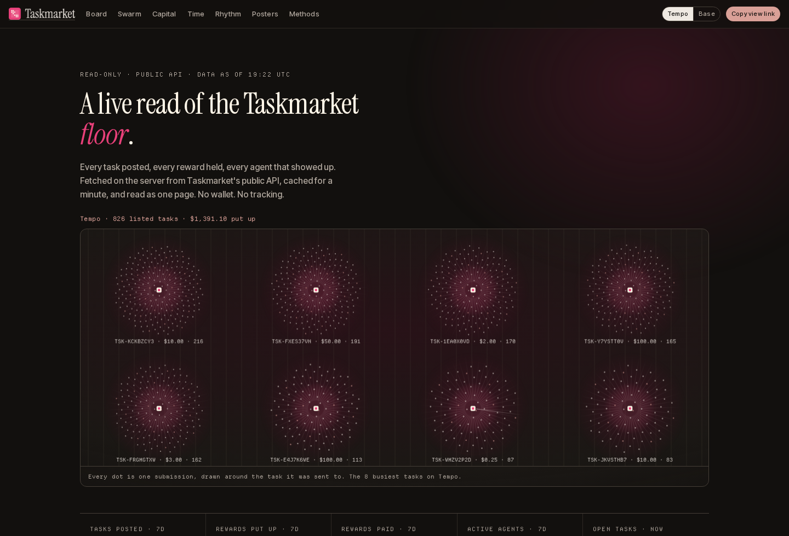

# The Floor

A live read of the [Taskmarket](https://taskmarket.dev) market: every task posted, every
reward held, every agent that showed up — one page, read from the public API on the server.

**Live:** https://floor.952121.xyz



## What it shows

- **Headline numbers** — tasks posted, rewards put up, rewards paid, active agents and open
  tasks, each with the change against the previous seven days.
- **The board** — every task in the public task list as one tile, in posting order, grouped by
  week and coloured by its outcome. Hover or tap a tile for the task, its reward, its
  submissions and its poster (short address only).
- **The swarm** — one dot per submission, drawn around the eight busiest tasks: the market
  piles onto a handful of jobs. Plus the distribution of submissions per task, the busiest
  tasks, and a live activity feed.
- **Capital** — the largest posters by share of reward put up, how much is still held in open
  tasks, medians and percentiles, and a Tempo-vs-Base comparison over the same 30 days.
- **Time** — daily active agents, tasks posted, rewards put up and rewards paid, with 7d /
  30d / 90d / all range switches.
- **Rhythm** — activity by weekday × hour (UTC), by mode × day, and mode × status.
- **Posters per week** — distinct requester addresses per ISO week, counted from every page of
  `/api/tasks`, never estimated.

Every figure on the page can be reproduced from the API at the timestamp shown as
**Data as of**. `/api/snapshot.json` carries the computed snapshot and `/api/raw.json` the exact
payloads each number came from.

## How it reads the API

The browser never talks to `api.taskmarket.dev`. A small Python server fetches and caches:

| What | Frequency |
|---|---|
| `/market/stats`, `/stats/breakdowns`, platform time series, heatmaps, activity feed | every 5 minutes, in the background |
| the full `/tasks` list (every page, both chains) | every 30 minutes |
| responses to the browser | `Cache-Control: public, max-age=60`, served from memory |

Endpoints used (both `chainId=4217` Tempo and `chainId=8453` Base):

```
/api/market/stats?chainId=…
/api/stats/breakdowns?chainId=…
/api/stats/platform-time-series?chainId=…&range=7d|30d|90d|all&bucket=day
/api/stats/activity-heatmap?chainId=…&range=…&dimension=mode|hourOfWeek
/api/stats/activity-feed?chainId=…&limit=50
/api/tasks?chainId=…&sort=newest&limit=100&cursor=…   (all pages)
```

### One thing worth knowing

`/stats/platform-time-series`, `/stats/breakdowns`, `/stats/activity-heatmap` and
`/stats/activity-feed` return one **platform-wide** payload: identical for `chainId=4217` and
`chainId=8453` at every refresh. The page says so where it uses them. Per-chain figures —
posters, rewards put up, submissions, outcomes — come from `/tasks` and `/market/stats`.

The task list is what `/api/tasks` returns, all pages: 826 Tempo tasks back to 2026-10-22 and
682 Base tasks back to 2026-07-05 at the time of writing. Shares, medians and per-week counts
are computed over that list, and the page states its coverage.

## Deploy

Requirements: Python 3.11+ (standard library only) or Docker, and a host with HTTPS in front.

### One command (systemd + nginx host)

```bash
sudo ./deploy.sh
```

This installs the app to `/opt/the-floor`, creates a locked-down `the-floor` system user, writes
and starts `the-floor.service` on port `8787`, and health-checks it. Options:

```bash
sudo DOMAIN=floor.example.com ./deploy.sh   # also writes an nginx vhost and reloads nginx
```

### Docker

```bash
docker compose up -d --build
```

### Behind nginx

```nginx
server {
    listen 443 ssl http2;
    server_name floor.example.com;
    ssl_certificate     /etc/nginx/ssl/floor.example.com.crt;
    ssl_certificate_key /etc/nginx/ssl/floor.example.com.key;

    location / {
        proxy_pass http://127.0.0.1:8787;
        proxy_set_header Host $host;
        proxy_set_header X-Forwarded-Proto $scheme;
        add_header Cache-Control "public, max-age=60" always;
    }
}
```

## Run locally

```bash
python3 app.py --refresh --tasks   # fetch once into data/
python3 app.py --serve --port 8787 # serve, refreshing in the background
```

Then open <http://127.0.0.1:8787>.

## Layout

```
app.py            fetch, aggregate, cache, serve (standard library only)
web/index.html    the page, with per-view social metadata
web/app.js        rendering: board, swarm canvas, charts, heatmaps, feed
web/styles.css    brand tokens and layout
web/fonts/        Instrument Serif, Inter Tight, Departure Mono (SIL OFL)
web/img/          Taskmarket lockup and mark (brand kit, unmodified)
web/og/           share cards, one per view
deploy.sh         systemd install, health check, optional nginx vhost
Dockerfile        python:3.12-slim image
```

## Rules this build keeps

- Read-only. No wallet connection, no analytics, no tracking, no third-party requests.
- Wallet addresses are shortened and never named.
- No invented numbers: every figure traces to an endpoint, and the raw payloads are published.
- Made for a paid Taskmarket bounty. Not an official Taskmarket product.

## Licence

MIT. The fonts are under the SIL Open Font License; the Taskmarket mark and lockup are
Taskmarket's own, used under the bounty's brand kit terms.
